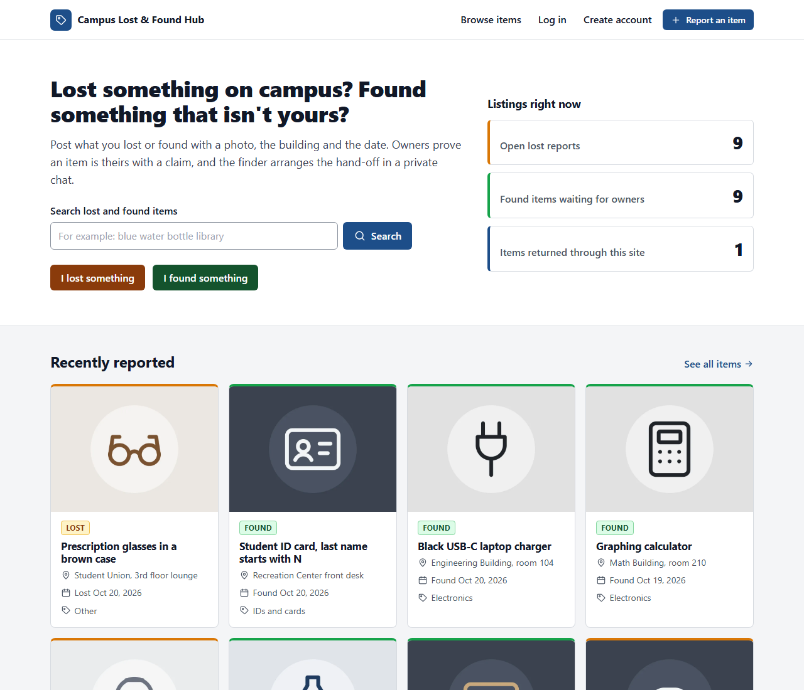
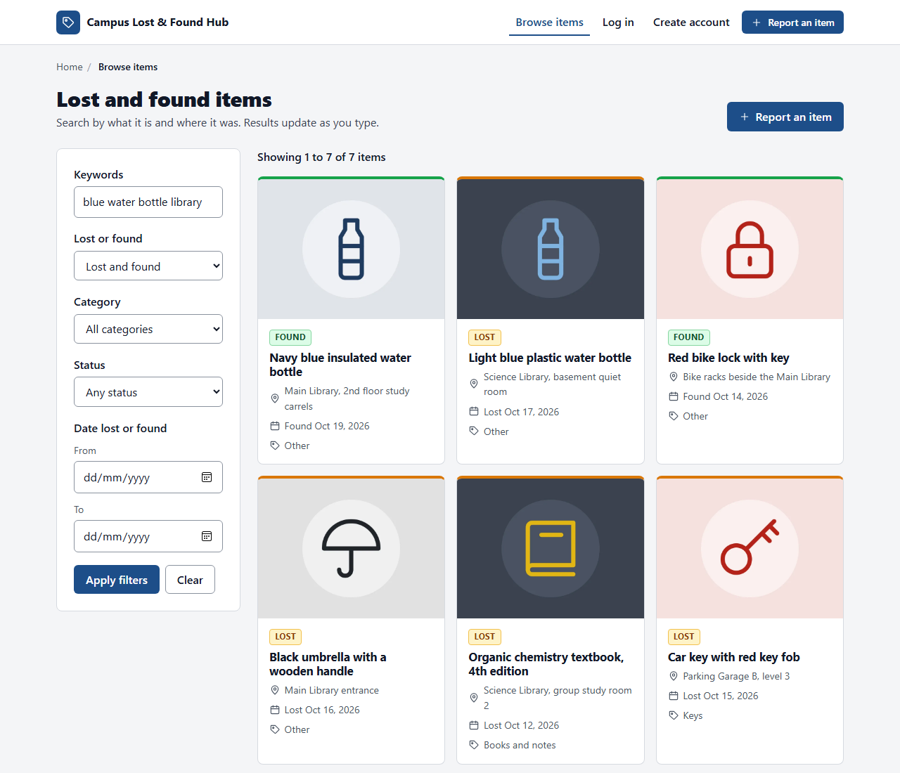
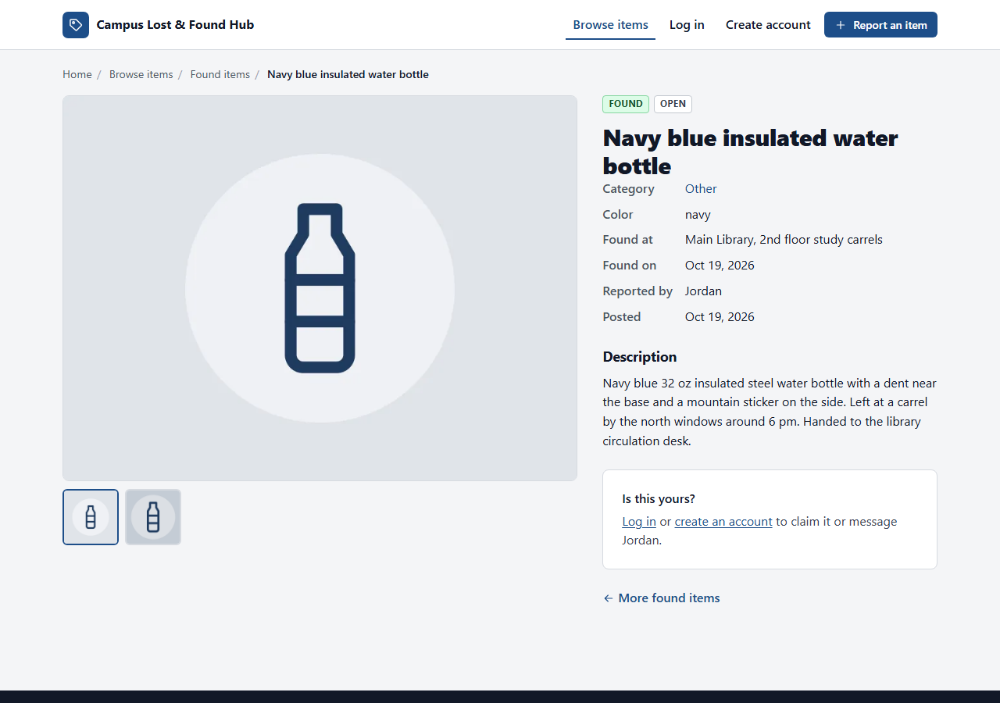
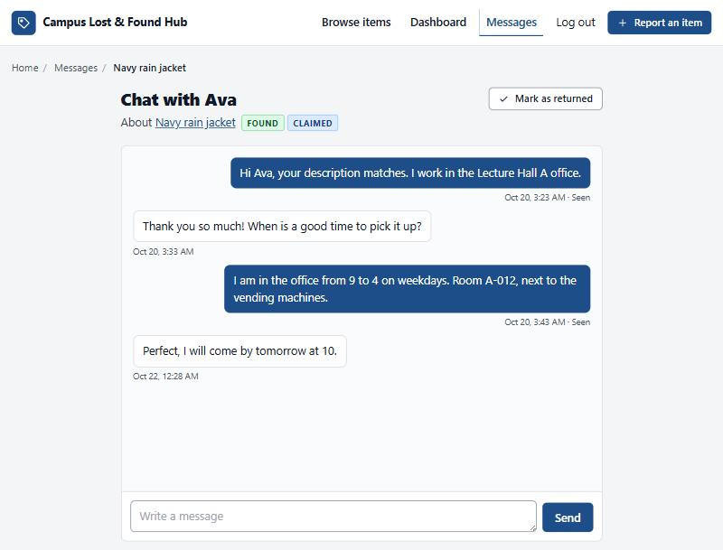
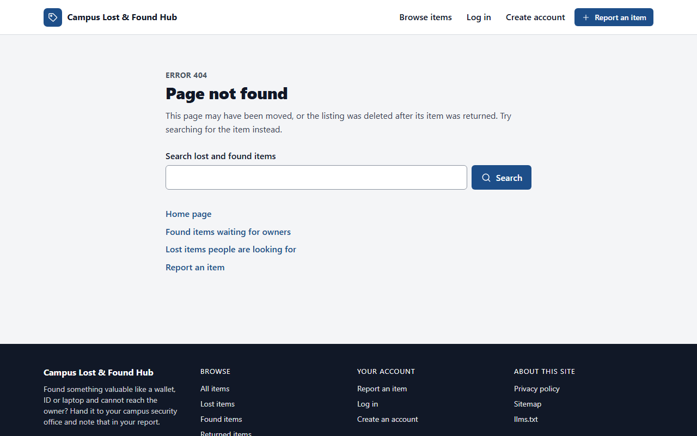

# Campus Lost & Found Hub

A university portal where students and staff report lost or found items, search every listing,
claim their belongings and arrange the hand-off in a private real-time chat with the finder.

Built with Node.js, Express 4, EJS, MongoDB (Mongoose), Socket.io and Tailwind CSS.

## Screenshots

| Home | Search results |
| --- | --- |
|  |  |

| Item detail | Chat |
| --- | --- |
|  |  |



The listing images in the demo data are generated illustrations (a line icon on the item's color),
created by the seed script. Real listings show the photos people upload.

## Features

- **Accounts:** register, log in and log out. Sessions are stored in MongoDB, passwords are hashed with bcrypt, and the session ID is regenerated on login.
- **Listings:** report a lost or found item with title, description, category, color, location, date and up to 4 photos. Only the reporter (or an admin) can edit or delete. Deleting removes the photos, claims and conversations too.
- **Uploads:** JPEG, PNG or WebP only, 5 MB each (configurable). The MIME type, the file extension and the file's first bytes are all checked. Files get random UUID names, and anything already written is deleted when a request is rejected. The browser shows previews and warns early.
- **Search:** full-text search over title, description and location, ranked by relevance, plus filters for type, category, status and date range. Filters live in the URL so results can be shared. The browse page filters live (300 ms debounce) through the JSON API and still works as a normal form without JavaScript.
- **Claims:** owners claim a found item by describing details only they would know. The finder approves or rejects. Approving marks the item as claimed, rejects the other pending claims and opens a chat. The finder marks the item as returned after the hand-off.
- **"I found this":** on a lost item, a finder sends the owner a private message that starts a conversation.
- **Real-time chat:** Socket.io rooms per conversation, typing indicator, read receipts, "load older messages" paging, a live unread badge in the header and pop-up notices for new messages and claim decisions. Messages are saved before they are broadcast. A plain form post works when the live connection is down.
- **Dashboard:** your listings, claims you made, claims waiting for your review and recent conversations.
- **Site essentials:** custom 404 and error pages, privacy policy, `sitemap.xml`, `robots.txt`, `llms.txt`, favicon set, canonical tags, meta descriptions, one `h1` per page, breadcrumbs with `BreadcrumbList` structured data, and JSON-LD for the home, browse and item pages.

## Requirements

- Node.js 20 or newer
- MongoDB 5 or newer (local install, Docker, or a MongoDB Atlas connection string)

## Setup

```bash
npm install
```

```bash
cp .env.example .env
```

Edit `.env` if your MongoDB is not at `mongodb://127.0.0.1:27017`. In development the app falls back to that
address and a development session secret, so it also starts without a `.env` file.

```bash
npm run seed
```

```bash
npm run dev
```

Open http://localhost:3000.

### Demo accounts

Created by `npm run seed`. Seeding deletes all existing data and refuses to run when `NODE_ENV=production`
unless you pass `--force`.

| Role | Email | Password | What to try |
| --- | --- | --- | --- |
| Student | ava@example.edu | AvaDemo#2026 | Has a pending claim to review on the laptop charger and an unread message about her backpack |
| Staff | jordan@example.edu | JordanDemo#2026 | Finder of the navy rain jacket, chatting with Ava about the hand-off |
| Admin | sam@example.edu | SamDemo#2026 | Can edit or delete any listing |

To see real-time chat, log in as Ava in one browser and as Jordan in a private window, then open the
"Navy rain jacket" conversation in both.

### Scripts

| Command | What it does |
| --- | --- |
| `npm run dev` | Starts the server with nodemon, restarting on changes in `src/` |
| `npm start` | Starts the server |
| `npm run seed` | Resets the database to the demo data |
| `node scripts/generate-icons.js` | Rebuilds `public/favicon.ico` and the icons in `public/img/` |

## Configuration

| Variable | Default | Purpose |
| --- | --- | --- |
| `PORT` | `3000` | HTTP port |
| `MONGODB_URI` | `mongodb://127.0.0.1:27017/campus-lost-found` (development only) | MongoDB connection string. Required in production |
| `SESSION_SECRET` | development-only value | Signs the session cookie. Required in production, at least 32 characters |
| `NODE_ENV` | `development` | `production` enables secure cookies, HSTS, proxy trust and the canonical-domain redirect |
| `MAX_UPLOAD_MB` | `5` | Maximum size of each uploaded image |
| `SITE_URL` | request host | Public origin, for example `https://lostandfound.example.edu`. Used for canonical tags, sitemap, robots.txt and llms.txt. Required in production |
| `SITE_CONTACT_EMAIL` | empty | Shown on the privacy policy page for data requests |

Generate a session secret with:

```bash
node -e "console.log(require('crypto').randomBytes(48).toString('hex'))"
```

## Deploying on a custom domain

1. **DNS:** at your DNS provider, point the domain at your server. Use an `A` record (and `AAAA` for IPv6) to the server's IP, or a `CNAME` to your host's hostname for a subdomain such as `lostandfound.example.edu`.
2. **Environment:** set `NODE_ENV=production`, `SITE_URL=https://lostandfound.example.edu`, `MONGODB_URI` and `SESSION_SECRET`.
3. **HTTPS and proxy:** run the app behind a reverse proxy that terminates TLS and forwards WebSocket upgrades. The app trusts one proxy hop in production so secure cookies and client IPs work. With Caddy, which gets certificates automatically:

   ```
   lostandfound.example.edu {
       reverse_proxy 127.0.0.1:3000
   }
   ```

   With nginx, include the WebSocket headers:

   ```
   location / {
       proxy_pass http://127.0.0.1:3000;
       proxy_http_version 1.1;
       proxy_set_header Upgrade $http_upgrade;
       proxy_set_header Connection "upgrade";
       proxy_set_header Host $host;
       proxy_set_header X-Forwarded-For $proxy_add_x_forwarded_for;
       proxy_set_header X-Forwarded-Proto $scheme;
   }
   ```

4. **Redirects:** in production, any request for another hostname (for example `www.` or the raw IP) gets a 301 to `SITE_URL`. `/healthz` is exempt for load balancer checks.
5. **Uploads:** keep the `uploads/` directory on persistent storage and include it in backups.
6. **Search engines:** submit `https://your-domain/sitemap.xml` in Google Search Console and Bing Webmaster Tools.

## Project structure

```
src/
  app.js              Express app: security headers, static files, sessions, routes
  server.js           HTTP server and Socket.io bootstrap
  config/             env.js, site.js, db.js, session.js, multer.js
  models/             User, Item, Claim, Conversation, Message
  controllers/        auth, item, claim, chat, page (home, dashboard, privacy, sitemap, robots, llms)
  routes/             auth, items, claims, chat, api, pages
  middleware/         requireAuth, requireOwner, validate, csrf, uploadImages, flash, locals, rateLimits, errorHandler
  services/           itemSearch, messaging, unread, files
  sockets/chat.js     All Socket.io event handlers
  views/              layouts/main.ejs, partials/, pages/
public/               css/app.css, js/ (search, chat, realtime, upload-preview, gallery), img/, favicon.ico
scripts/              seed.js, generate-icons.js
uploads/              Uploaded images (not committed)
```

## API reference

All responses are JSON. Errors always use `{ "error": { "message": "...", "details": [{ "field", "message" }] } }`,
where `details` is present for validation errors. Write requests need the session cookie and an
`X-CSRF-Token` header (the token is in the `csrf-token` meta tag on any page while logged in).

| Method | Path | Auth | Description |
| --- | --- | --- | --- |
| `GET` | `/api/items` | No | Search and filter. Query: `q`, `type` (lost, found), `category`, `status` (open, claimed, resolved), `from`, `to` (YYYY-MM-DD), `page`, `limit` (1 to 48, default 12). With `q`, results are sorted by text score, then newest. Returns `{ items, page, totalPages, total }` |
| `GET` | `/api/items/:id` | No | One item. Returns `{ item }` |
| `POST` | `/api/items` | Yes | Create an item. `multipart/form-data` with the item fields and up to 4 `images`. Returns `201 { item }` |
| `PATCH` | `/api/items/:id` | Reporter or admin | Update any item field, `status` (open or resolved), `removeImages` (paths to delete) and new `images`. JSON or multipart. Returns `{ item }` |
| `DELETE` | `/api/items/:id` | Reporter or admin | Delete the item, its images, claims and conversations. Returns `204` |
| `GET` | `/api/conversations/:id/messages` | Participant | Message history, oldest first. Query: `before` (message id), `limit` (1 to 100, default 50). Returns `{ messages, hasMore }` |

Item fields: `type`, `title` (3 to 100 chars), `description` (10 to 2000), `category` (electronics, ids-cards, keys,
bags, clothing, books, jewelry, other), `color` (optional, up to 30), `location` (2 to 100), `dateLostOrFound` (YYYY-MM-DD, not in the future).

| Status | When |
| --- | --- |
| `400` | Invalid query parameters, malformed JSON, or a rejected upload type |
| `401` | Not logged in |
| `403` | Not the owner, or missing or invalid CSRF token |
| `404` | Item, conversation or route not found (also returned for conversations you are not part of) |
| `413` | An image is larger than `MAX_UPLOAD_MB` |
| `422` | Invalid body fields, with `details` per field |
| `429` | Rate limit reached |

## Socket.io events

The client connects to the same origin. Connections are authenticated with the existing login session
and rejected without one, and cross-origin connections are refused. Each user also joins a private room
for notifications.

| Direction | Event | Payload | Notes |
| --- | --- | --- | --- |
| Client to server | `conversation:join` | `{ conversationId }` | Joins the room only if you are a participant (checked in the database). Acknowledged with `{ ok }` or `{ ok: false, error }` |
| Client to server | `message:send` | `{ conversationId, body }` | Body is trimmed and capped at 2000 characters, saved, then broadcast. Limited to 10 messages per 10 seconds per socket. Acknowledged with `{ ok, message }` |
| Client to server | `typing` | `{ conversationId, isTyping }` | Relayed only to rooms you joined |
| Client to server | `message:read` | `{ conversationId }` | Marks the other person's messages as read |
| Server to client | `message:new` | `{ message }` | `message` is `{ id, conversationId, sender: { id, firstName }, body, readBy, createdAt }` |
| Server to client | `typing` | `{ conversationId, userId, isTyping }` | |
| Server to client | `message:read` | `{ conversationId, userId }` | Sent to the room so the sender can show "Seen" |
| Server to client | `notification` | `{ conversationId, preview, unreadTotal }` | Sent to the recipient's private room for new messages and claim decisions. `conversationId` is `null` for claim notices |
| Server to client | `unread:count` | `{ total }` | Sent to your own tabs after you read messages, to update the header badge |

## Security

- `helmet` with a Content Security Policy that allows only this origin plus the Tailwind stylesheet from jsDelivr (pinned with Subresource Integrity). Inline JSON-LD uses a per-request nonce.
- CSRF tokens on every state-changing request (form field or `X-CSRF-Token` header). File uploads are checked after the multipart body is parsed, and their files are deleted if the token is wrong.
- Ownership is always checked against the logged-in session, never against IDs sent by the client.
- Rate limits on login and registration, the API, and creating listings, claims and messages.
- Query strings are parsed as plain strings, and every input is validated with `express-validator`.
- All user content is escaped by EJS (`<%= %>`) on the server and inserted with `textContent` in the browser.
- Errors are logged on the server. Clients only see a safe message, never a stack trace, in production.
- The Socket.io browser client is served from this origin without its source map reference, and the app has no build step, so no source maps are published.

## Styling

- **Themes:** light and dark, swapped with one click on the sun/moon button in the header. Until it is used, the system setting decides. The choice is saved in `localStorage` and applied before first paint, and switching reveals the new theme as a circle growing from the toggle where the browser supports View Transitions. All colors are CSS custom properties in `public/css/app.css`, and every text and background pair meets WCAG AA in both themes.
- **Type:** Archivo (headings) and Public Sans (body), self-hosted from `public/fonts/` under the SIL Open Font License.
- **Background:** an animated topographic map behind every page. Contours drift slowly, a hill rises under the pointer and follows it on a spring, and a click or tap sends a ripple across the map. It is ported to plain JavaScript from the Animate UI "Topography Background" component (MIT License, via 21st.dev) in `public/js/topography.js`: a WebGL shader with a Canvas 2D fallback, tinted from the theme, paused while the tab is hidden, and a still frame with reduced motion. Without JavaScript a static contour tile (`node scripts/generate-topography.js`) is shown instead.
- **Header menus:** "Browse items" (with a "By category" submenu), and the account menu follow the shadcn/Radix dropdown-menu pattern, rebuilt without a framework in `public/js/dropdown.js`: full keyboard support (arrows, Home, End, typeahead, Escape, Tab), hover highlighting, submenus that flip to stay on screen, and fade, zoom and slide animations in both themes. Without JavaScript every trigger is a plain link. Menu glyphs use Lucide path data (ISC License).
- **Nav hover:** links roll their label up to an accent-colored copy while an underline sweeps in from the left.
- **Cursor:** on mouse and trackpad devices a dot tracks the pointer and a ring follows with spring lag, stretching in the direction of travel; over buttons and nav links the ring wraps the element and the element leans toward the pointer. The system cursor stays visible, and the effect is off on touch devices and with reduced motion (`public/js/cursor.js`).
- **Motion:** buttons lift slightly with a single sweep of light on hover and press in on click; submitted buttons show a spinner; a thin bar at the top tracks page navigation; new chat messages and live search results ease in. Everything respects `prefers-reduced-motion`.
- **Page loader:** on the first page of a browser session, a branded intro plays for about 2.9 seconds: the logo tile pops in at the center of a celestial orrery whose orbit rings draw themselves, the tag outline draws on the tile, then planets in the brand blue, lost amber and found green turn on their arms (the outer one with a moon), the name rises in letter by letter (the ampersand in the lost amber), then a glowing horizon line opens before the screen lifts away. Any click, tap or key skips it, reduced motion shortens it to half a second, and it hides itself after 4.4 seconds even if JavaScript fails. The horizon effect is ported to plain CSS from the 21st.dev community component [Horizon Page Loader](https://21st.dev/@johnmamanao/components/horizon-page-loader) by johnmamanao. To see it again, open the site in a new tab or window.

## Notes

- Tailwind is loaded as the precompiled v2.2.19 stylesheet from jsDelivr. The newer browser builds compile CSS in the page and print a production warning in the console, which this build avoids.
- Rate limit counters and Socket.io rooms are kept in memory, which suits a single server process. To run several instances, add a shared store for `express-rate-limit` and the Socket.io Redis adapter.
